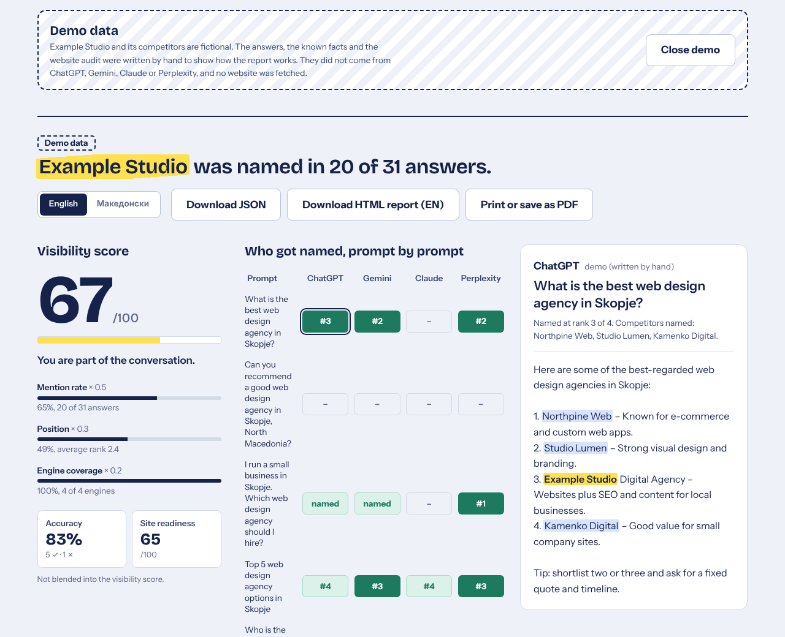
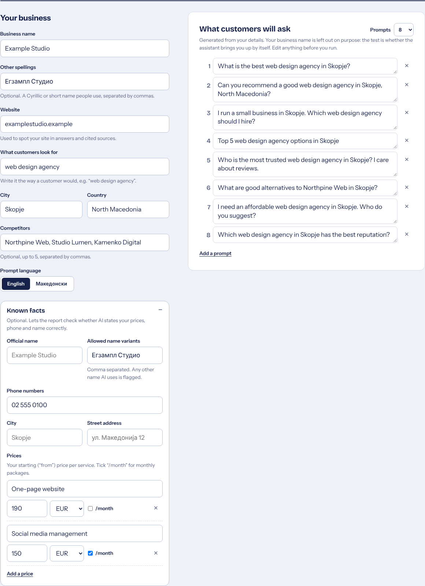
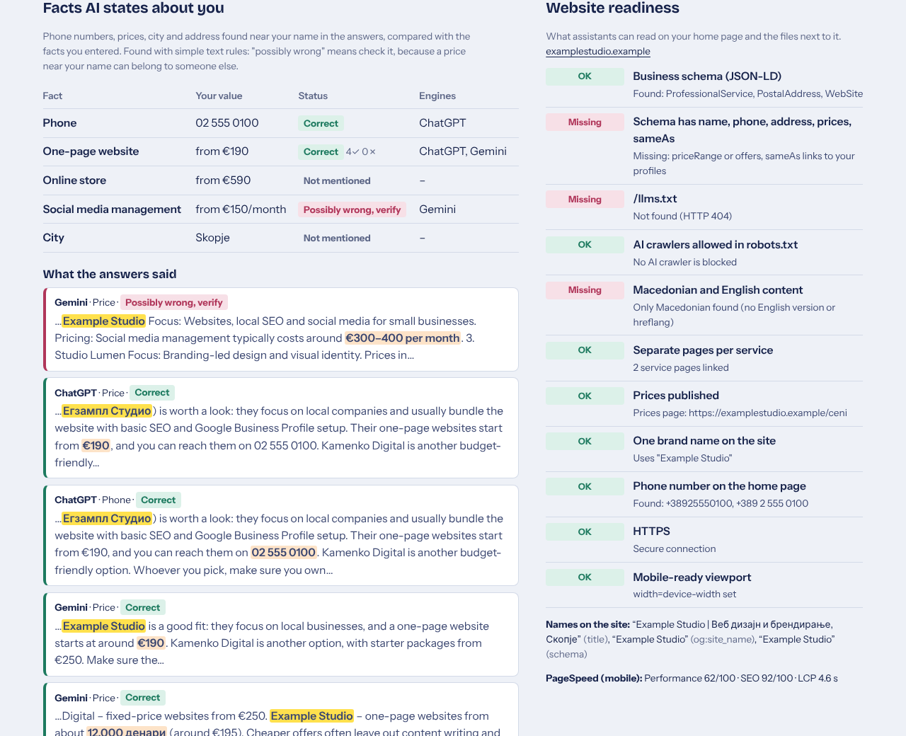
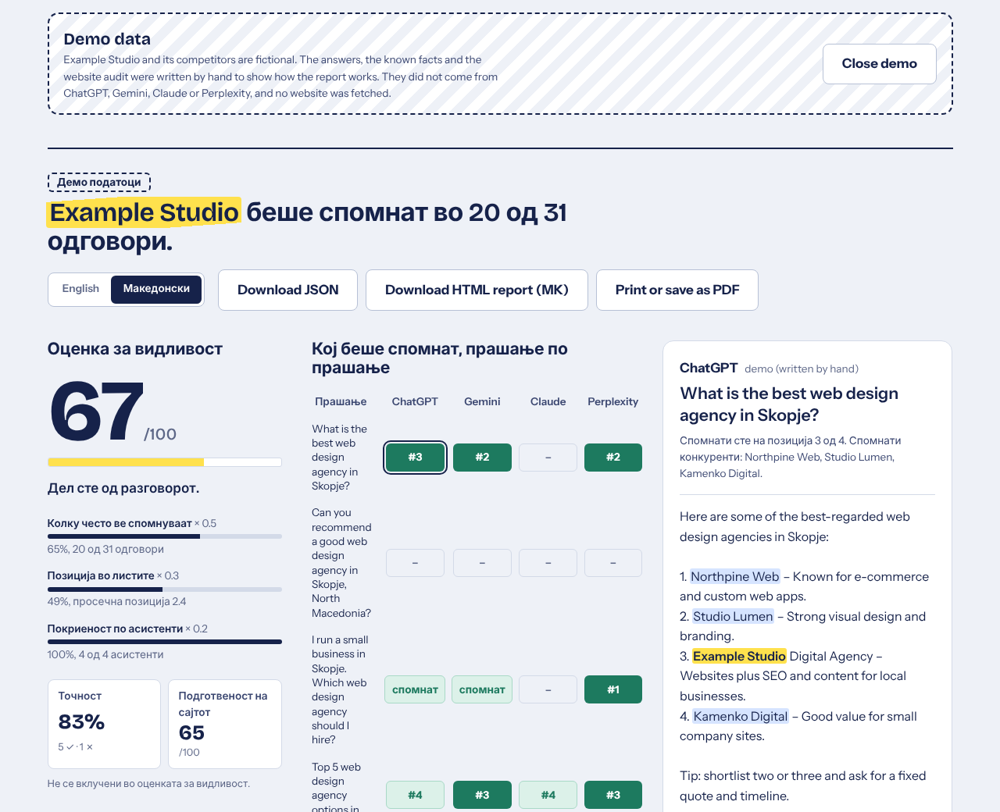

# AI Visibility Checker (GEO)

Find out whether ChatGPT, Gemini, Claude and Perplexity name your business when a customer asks them for a recommendation, whether the facts they state about you (prices, phone, name) are right, and what on your website to fix, with a report you can hand to a client in English or Macedonian.



*The screenshots show **demo data**: Example Studio and its competitors are fictional, and the answers, known facts and website audit were written by hand. See [Demo mode](#demo-mode).*

## The problem

People used to type "web design agency Skopje" into Google and scroll a list of ten links. More and more of them now ask an AI assistant instead: *"Who should I hire to build a website for my restaurant in Skopje?"* The assistant answers with three to five names. If your business is not one of them, you were never in the running, and no analytics tool will tell you that it happened.

Optimising for these answers is often called **GEO** (generative engine optimisation). The first step is measuring where you stand.

## What the tool does

1. **You describe the business**: name, other spellings (for example the Cyrillic form), website, what customers look for, city, country, up to five competitors, and the prompt language (English or Macedonian).
2. **Optionally, you enter known facts**: official name and allowed name variants, phone numbers, city and street address, and price items (label, amount, currency, per month or not). These are what the answers are checked against.
3. **It writes buyer-style prompts** from fixed templates: "What is the best web design agency in Skopje?", "What are good alternatives to Northpine Web in Skopje?" and so on. Default 8, maximum 15. Generation is deterministic, the business name is never put into a prompt (the point is to see whether the assistant brings you up by itself), and you can edit, add or remove prompts before running.
4. **It asks each configured engine** (OpenAI, Google Gemini, Anthropic Claude, Perplexity) every prompt through a Netlify Function. Keys stay on the server. Unconfigured engines are shown as unavailable.
5. **It audits the website** in parallel (on by default, needs a domain): schema.org JSON-LD and its fields, `/llms.txt`, AI crawlers in `robots.txt`, Macedonian and English content, service and pricing pages, the brand names the site shows, phone numbers, HTTPS and mobile viewport, and optionally Google PageSpeed.
6. **It analyses every answer**: are you named, at what rank, which competitors are named, which URLs were cited, and which phone numbers, prices, city and address it states near your name.
7. **It scores the run** (visibility score 0 to 100, plus separate Accuracy and Site readiness sub-scores), builds a share-of-voice table, lists the cited sources, and produces a prioritised, evidence-based checklist of fixes in English and Macedonian, with items the audit shows are already done marked as done.
8. **It exports** the full report as JSON, as a standalone HTML file in English or Macedonian, or as a PDF through the browser's print dialog.

The result matrix fills in live as answers arrive. Click any cell to read the answer with your name highlighted in yellow and competitors in blue.



## How the analysis works

### Mention detection

Names are compared on a normalised "skeleton" of the text, so the same business is found however it was written:

| Check | Example that matches "Sharena Kjesa" or "Example Studio" |
| --- | --- |
| Exact | `Example Studio` |
| Case, punctuation, markdown | `EXAMPLE STUDIO`, `**Example-Studio**` |
| Diacritics | `Šarena Ḱesa` |
| Macedonian Cyrillic and Latin, both ways | `Шарена Ќеса`, `Sarena Kesa` |
| Joined or split words | `ExampleStudio` |
| Legal suffixes dropped | `Example Studio DOOEL`, `д.о.о.е.л.` |
| Fuzzy (1 typo from 6 characters, 2 from 12, first letter must match) | `Exampel Studio` |
| Domain (only if the name is absent) | `examplestudio.mk/contact`, `blog.examplestudio.mk` |

Short names (under 6 characters) never fuzzy-match, and a name is not matched inside a longer word ("Examples of studios" does not count as "Example Studio"). URLs are hidden from name matching so a domain counts as a domain mention.

### Rank in lists

Numbered lists in common markdown styles (`1.`, `2)`, `### 3. Name`, `**4.** Name`), top-level bullets, and markdown tables are read as ranked lists. The rank is the order in the text, not the printed number. The business gets the rank of the item whose *name part* (bold text, link text, or text before `–`, `:` or `|`) mentions it, so being mentioned in another agency's description ("cheaper than Example Studio") does not steal that agency's rank.

### The score

```
score = round(100 × (0.5 × M + 0.3 × P + 0.2 × C))
```

| Part | Meaning |
| --- | --- |
| **M**, mention rate | Answered prompts that name the business ÷ answered prompts |
| **P**, position quality | Average of the position value below over all answered prompts (0 when not named) |
| **C**, engine coverage | Engines that named the business at least once ÷ engines that answered |

| Where the business appeared | Position value |
| --- | --- |
| Rank 1 | 1.00 |
| Rank 2 | 0.85 |
| Rank 3 | 0.70 |
| Rank 4 | 0.55 |
| Rank 5 | 0.45 |
| Rank 6 to 10 | 0.30 |
| Rank 11 or lower | 0.20 |
| Named in an answer with no list | 0.60 |
| Named, but outside the list the answer gave | 0.35 |
| Not named | 0 |

Failed calls (timeouts, provider errors) are left out of every denominator, so an outage lowers the number of answers, not the score.

Bands: 0 to 19 *invisible*, 20 to 44 *emerging*, 45 to 69 *visible*, 70 to 100 *leading*.

The formula lives in [`src/lib/scoring.ts`](src/lib/scoring.ts) and is covered by tests, including a worked example.

The visibility score only looks at whether and where you are named. Accuracy and Site readiness are reported next to it, not mixed into it (see [Sub-scores](#sub-scores-not-blended-into-the-visibility-score)).

### Share of voice

For the business and each competitor: the number of answers that name it, its share of all such mentions, and its average rank when listed.

### Fact accuracy check ("Facts AI states about you")

[`src/lib/facts.ts`](src/lib/facts.ts). For each answer that names the business:

1. The answer is split into blocks: one per list item, heading section (`### Name` or a bold line like `**1. Name**` with its bullets), table row or paragraph.
2. Around each mention of the business (name, other spellings, allowed variants, domain), a window is taken inside its block: 150 characters before and 400 after, or the whole list item when the name is in its first line, and cut where a listed competitor is named. So "NULA from €190, while Studio X charges €500" only gives NULA €190.
3. Inside the windows it extracts:
   - **prices**: `€190`, `190 €`, `190 EUR`, `од 190 евра`, `12.000 денари`, `12 000 ден.`, `$500`, ranges (`190-300 €`, `€300–400+`, `од 300 до 400 евра`), "from" (`from`, `starting at`, `од`, `почнувајќи од`) and per month (`/month`, `/mo`, `per month`, `monthly fee of`, `месечно`, `на месец`, `месечна претплата од`);
   - **phone numbers** in local and international form (`073 745 473`, `+389 73 745 473`, `073/745-473`, `(02) 3123 456`, `+389 (0)73 ...`), compared by national digits;
   - **city**, only when it comes with a location cue ("based in", "from", "со седиште во", "од"), so a city that just echoes the prompt is not counted; a small list of Macedonian towns and nearby capitals is used to spot a wrong one;
   - **street address** (`ул.`, `улица`, `ul.`, `бул.`, `street`, `Address:`).
4. Each claim is compared with the known facts:
   - prices are matched to price items with the same per-month flag, preferring items whose label fits the surrounding words (English and Macedonian synonyms: web/сајт/страница, social/мрежи, shop/продавница, ...). The stated lower bound counts as **correct** within ±6% (at least €2) of your price. Denars are converted at a fixed **61.5 MKD/EUR**. A stated monthly price when you listed no monthly price, or a dollar price, is **unverified**;
   - anything else that does not match is **possibly wrong, verify**. The tool never says a claim is certainly wrong.
5. It also collects the **names the answers used** (the bold or link text around the mention, or the name plus the capitalised words after it, without the city) and labels each as official, allowed, or not your name. "NULA Digital Agency" when your site says "NULA" shows up here.

Without known facts, the claims are still listed, marked as not checked.



### Website audit (GEO checks)

`POST /api/audit` ([`netlify/functions/audit.ts`](netlify/functions/audit.ts)) fetches the home page, `/llms.txt`, `/robots.txt` and the sitemap through the SSRF guard ported from nula-lead-finder ([`server/audit/`](server/audit)), and [`server/geo.ts`](server/geo.ts) reads:

| Check | What is read |
| --- | --- |
| Business schema | JSON-LD (including `@graph`) with an Organization, LocalBusiness or subtype node |
| Schema fields | `name`, `telephone`, `address`, `priceRange` or `makesOffer`/`offers`/`hasOfferCatalog`, `sameAs`; also `alternateName` |
| llms.txt | `/llms.txt` returns 200, is not HTML and has content |
| AI crawlers | `robots.txt` rules that disallow `/` for GPTBot, OAI-SearchBot, ChatGPT-User, ClaudeBot, Claude-SearchBot, PerplexityBot, Google-Extended, Googlebot, Bingbot, CCBot |
| Languages | `<html lang>`, `hreflang` links, share of Cyrillic text, English words, language-switcher links (`EN`, `МК`, `/en/`) |
| Service pages | same-site links whose path or text looks like a service or prices page (`/uslugi/...`, `/ceni`, "Веб дизајн", ...); in-page `#services` anchors are counted as sections, not pages |
| Brand names | `<title>`, `og:site_name`, `application-name`, schema `name` |
| Phone | `tel:` links and schema `telephone`, compared with your known phone |
| HTTPS, mobile | final URL, http to https redirect, `width=device-width` viewport |
| PageSpeed | Google PageSpeed Insights (mobile), only when `PAGESPEED_API_KEY` is set |

A side file that times out is "unknown", not "missing".

### Sub-scores (not blended into the visibility score)

**Accuracy**, shown as a percentage:

```
accuracy = round(100 × correct ÷ (correct + possibly wrong))
```

over all price, phone, city and address claims in this run. Unverified claims are left out. It is empty ("–") when nothing could be checked.

**Site readiness**, 0 to 100:

```
readiness = round(100 × Σ weight(passed checks) ÷ Σ weight(passed + failed checks))
```

| Check | Weight |
| --- | --- |
| Business schema present | 2 |
| Schema has name, telephone, address, prices, sameAs (all five) | 2 |
| `/llms.txt` present | 1 |
| No AI crawler blocked in robots.txt (no robots.txt counts as a pass) | 1 |
| Macedonian and English content | 1 |
| At least two service pages (the prices page does not count) | 1 |
| Prices published (a prices page, or prices in schema) | 1 |
| One brand name on the site (title contains it; og:site_name and schema name equal it or an allowed variant) | 1 |
| Phone on the home page (your known phone, if entered) | 0.5 |
| HTTPS, and http redirects to https | 0.5 |
| Mobile viewport | 0.5 |

Checks that could not be evaluated are left out of both sums. The formula lives in [`src/lib/readiness.ts`](src/lib/readiness.ts).

The two sub-scores stay separate on purpose: a well-prepared site can still be invisible, and a well-known business can be named with a bare site.

### Recommendations

[`src/lib/recommendations.ts`](src/lib/recommendations.ts) is a rule engine with no LLM. Each item has an id, priority, status (to do, or **done** when this run's evidence shows it is in place), a title, a "why" that quotes this run's evidence, and concrete steps, all in English and Macedonian. Schema and llms.txt items include a copy-paste draft built from your known facts (never with invented URLs).

| Item | Raised when / evidence used |
| --- | --- |
| Correct the facts AI gets wrong | Any "possibly wrong" claim, quoted (“Gemini stated "€300–400 per month"; your price for Social media management is from €150/month”). Steps say where to update: the prices page found by the audit, Google Business Profile (Gemini), Bing (ChatGPT search), the cited sources (Perplexity), schema and llms.txt. Done when every checked fact was correct |
| Google Business Profile | Always. High below 50% mention rate, when Gemini answered but never named you, or when Gemini stated wrong facts (Gemini relies on Google data). Lists your services with prices for the profile |
| LocalBusiness schema | From the audit: missing schema, missing fields by name, or a schema phone that differs from yours. Done when complete. Without an audit, from the mention rate |
| Name, address, phone | Name variants the answers used, other names on the site, a different phone on the home page, or engines that disagree. Done when every answer used an allowed name |
| AI crawlers | Bots blocked in robots.txt. Done when none are |
| Reviews | A competitor named more often or ranked better, average rank worse than 2, or mention rate below 50% |
| One page per service | From the audit: fewer than two service pages, services as #sections, and known price items with no page of their own. Done otherwise |
| Directory listings | Domains cited in answers that did **not** name you, with counts; your site never cited |
| Macedonian and English | From the audit (only one language found). Without an audit, Macedonian prompts and low mention rate |
| llms.txt | From the audit. Done when present |
| Bing Webmaster Tools and Bing Places | Always (Copilot answers from Bing; this tool cannot test Copilot) |
| Speed and mobile | Only when the audit finds no viewport, no HTTPS, PageSpeed performance below 50 or LCP above 4 s. Done when PageSpeed ran and was fine |

### Report language

The app's controls stay in English. The report (on screen, HTML export and print/PDF), the recommendations and the fact check switch between **English and Македонски** with the toggle above the results. Report text lives in [`src/lib/i18n.ts`](src/lib/i18n.ts); recommendations carry both languages, so the JSON export has both.



## Limitations

- **Answers are not deterministic.** The same prompt can produce a different list a minute later. A report is a snapshot of one run. Run the same prompts every few weeks and compare trends, not single answers.
- **API answers are not app answers.** The APIs do not see a user's location, history or memory, and the consumer apps may use different models, system prompts and search. Claude and OpenAI answer from model knowledge unless you turn on OpenAI web search (`OPENAI_WEB_SEARCH=true`); Gemini answers from model knowledge unless `GEMINI_GROUNDING=true`; Perplexity always searches the web. A manual check in the ChatGPT or Gemini app can give a different answer.
- **No Copilot.** Microsoft Copilot has no public API for this. It is covered only indirectly, through the Bing Webmaster Tools / Bing Places recommendation.
- **Fact extraction is heuristic.** Text rules find prices and phones near your name. A price for a competitor or a generic market price in the same paragraph can be attributed to you, which is why the status is "possibly wrong, verify". Prices written in words ("two hundred euros"), in images, or far from the name are missed. Denars use a fixed 61.5 MKD/EUR; dollar prices are only compared with dollar prices.
- **The audit reads one page.** It checks the home page and the files next to it (`llms.txt`, `robots.txt`, sitemap), not every page, and it does not run JavaScript, so content rendered only in the browser (some single-page apps) is invisible to it, as it is to many crawlers. Sites that block automated requests return an error.
- **Each run costs money.** A run makes `prompts × engines` API calls (32 with the defaults and four engines), billed to your keys. Output is capped by `MAX_OUTPUT_TOKENS`; web search, grounding (Gemini 3 and newer bill per search query) and larger models cost more. Check each provider's current pricing.
- **Matching is heuristic.** Fuzzy matching can, rarely, match a similarly named business. Names that sound alike but are spelled differently across scripts (for example "Example" and "Егзампл") need to be added as other spellings.
- **Prompts that name a competitor** ("alternatives to Northpine Web") usually get that competitor repeated in the answer, which counts toward its share of voice.
- **The rate limits are in memory** and per function instance. They slow casual abuse; they are not a security boundary. Put the deployment behind authentication or a WAF if you share it publicly with your keys.
- **Provider APIs change.** Model names are environment variables for that reason. Perplexity has announced that Sonar Chat Completions is being moved to its Agent API; if the default endpoint stops working, set `PERPLEXITY_API_URL` or update `server/providers.ts`.

## Run it locally

Requirements: Node.js 20 or newer.

```bash
npm install
npm run dev            # UI only, at http://localhost:5173 (no engines or audit; the demo report works)
```

To call real engines locally, run the UI and the functions together with the Netlify CLI:

```bash
cp .env.example .env   # add at least one API key
npm run dev:netlify    # netlify-cli, http://localhost:8888
```

Other scripts:

```bash
npm test               # Vitest unit tests
npm run lint           # ESLint
npm run typecheck      # TypeScript, strict
npm run build          # type-check and production build into dist/
```

## Environment variables

All variables are read by the Netlify Functions only. None is sent to the browser.

| Variable | Default | Purpose |
| --- | --- | --- |
| `ACCESS_CODE` | | **Required for live checks.** At least 8 characters. The browser sends it in the `x-access-code` header; without a configured code, `/api/ask` and `/api/audit` refuse every call (fail closed) |
| `MONTHLY_LIMIT_GEMINI` | `4500` | Monthly request cap for Gemini (below the 5,000 grounded requests a month in Gemini's paid tier). `0` disables the engine |
| `MONTHLY_LIMIT_OPENAI` / `_ANTHROPIC` / `_PERPLEXITY` | `1000` | Monthly request caps for the paid engines |
| `MONTHLY_LIMIT_AUDIT` | `300` | Monthly cap on website audits |
| `ANTHROPIC_API_KEY` | | Enables Claude |
| `ANTHROPIC_MODEL` | `claude-sonnet-5-5` | Claude model ID |
| `OPENAI_API_KEY` | | Enables ChatGPT (OpenAI Responses API) |
| `OPENAI_MODEL` | `gpt-6-luna` | OpenAI model ID |
| `OPENAI_REASONING_EFFORT` | `low` | Sent as `reasoning.effort`; set it empty for models without reasoning |
| `OPENAI_WEB_SEARCH` | `false` | `true` adds the `web_search` tool (closer to ChatGPT with search, costs more) |
| `PERPLEXITY_API_KEY` | | Enables Perplexity |
| `PERPLEXITY_MODEL` | `sonar` | Perplexity model ID |
| `PERPLEXITY_API_URL` | `https://api.perplexity.ai/v1/sonar` | Endpoint for Sonar requests |
| `GEMINI_API_KEY` | | Enables Gemini (Gemini API `generateContent`, key sent in the `x-goog-api-key` header) |
| `GEMINI_MODEL` | `gemini-3.8-flash` | Gemini model ID |
| `GEMINI_GROUNDING` | `false` | `true` adds Grounding with Google Search (closer to the Gemini app; search queries are billed). Grounding sources are reported by domain, because Google returns expiring redirect links |
| `GEMINI_FALLBACK_MODEL` | `gemini-3.7-flash` | Tried when the main Gemini model answers 429/5xx (e.g. "high demand"), after one retry of the main model. Empty disables it. The answer shows which model replied |
| `GEMINI_THINKING_LEVEL` | `low` | Sent as `generationConfig.thinkingConfig.thinkingLevel`; set it empty to omit it |
| `PAGESPEED_API_KEY` | | Optional. Adds Google PageSpeed Insights (mobile) to the website audit. The GEO checks run without it |
| `ENGINE_TIMEOUT_MS` | `20000` | Timeout per engine call (2,000 to 28,000; Netlify stops synchronous functions at 30 s) |
| `MAX_OUTPUT_TOKENS` | `900` | Output cap per answer |
| `RATE_LIMIT_REQUESTS` | `45` | Requests per IP per window (one request is one prompt) |
| `RATE_LIMIT_WINDOW_MS` | `900000` | Rate-limit window (15 minutes) |

The website audit has its own fixed limit: 12 audits per IP per 15 minutes.

Default model IDs were checked against the providers' documentation in November 2026. Models are renamed often; override them here rather than in code.

## Deploy to Netlify

1. Push the repository to GitHub.
2. In Netlify, choose **Add new site → Import an existing project** and pick the repository. `netlify.toml` already sets the build command (`npm run build`), the publish directory (`dist`) and the functions directory (`netlify/functions`).
3. Under **Site configuration → Environment variables**, add `ACCESS_CODE` and the keys for the engines you want (any subset). Mark them as secret.
4. Optionally add `PAGESPEED_API_KEY` for PageSpeed in the website audit.
5. Deploy. The header shows which engines are live. With no keys, live checks are disabled and the demo report is offered instead.

## Safety guards

- **Access code:** live runs and audits spend the owner's API credit, so both functions require `ACCESS_CODE` (constant-time comparison of SHA-256 digests). If it is not configured, they refuse every call. Ten wrong codes per IP per 15 minutes trigger a lockout. The code is kept in the owner's browser (localStorage) only.
- **Monthly caps:** every engine call and audit is counted per calendar month (UTC) in Netlify Blobs before it runs, and refused once the cap is reached. If the counter is unavailable, calls are refused (fail closed). The store is not transactional, so simultaneous requests can overshoot by a few; caps sit below the real provider limits for that reason. For a hard stop, also set a daily quota on the API in Google Cloud Console.
- API keys exist only in function environment variables; `/api/engines` returns engine names and models, never keys.
- One prompt per request, at most 300 characters, at most 4 engines, at most 15 prompts per run (tracked per run ID and IP), JSON bodies up to 4 KB.
- The website audit only fetches public http(s) URLs: no credentials, standard ports only, no local or private hostnames or IPs (decimal, hex, octal and IPv6 forms included), every DNS answer must be public, a connect-time lookup blocks DNS rebinding, every redirect (at most 5) is checked again, 8 s timeout for the page and 5 s for side files, 2 MB cap on the page and 64 KB on side files after decompression, and only HTML/text bodies are read. Errors are returned as fixed messages without internal details.
- Temporary upstream errors (429/5xx, network) get one retry after a short backoff, all inside the engine timeout; the monthly caps count prompts, so with retries the provider can see up to 3 requests per prompt (Google's daily quota still applies).
- In-memory rate limit per IP, a timeout on every engine call, and `Promise.allSettled` so one failing engine never breaks a run.
- Cross-origin browser requests are rejected. Provider error messages are shortened and scrubbed of anything that looks like a key (including Google `AIza...` keys).
- Everything rendered from an answer is treated as text; the HTML export escapes every value.

## Demo mode

When no engine has a key, the app offers **Open demo report**. It loads a bundled example for **Example Studio, Skopje**, a fictional business, with fictional competitors (Northpine Web, Studio Lumen, Kamenko Digital, Vardar Web Lab) on reserved `.example` domains. The 32 answers (8 prompts × ChatGPT, Gemini, Claude, Perplexity) were written by hand to exercise the analysers: lists, a table, Gemini-style bold headings with bullets, a prose mention, a typo match, a Cyrillic alias, one failed call, a longer name variant ("Example Studio Digital Agency"), a correct €190 price and phone, a denar price, and a Gemini social-media price of €300–400 per month against a known €150/month. The known facts and the website audit are invented too, and no website is fetched. None of it came from an AI engine. The UI, the HTML export (both languages) and the export file name all carry a "demo data" label. The demo runs through the same analysis code as a live run.

## Project structure

```
src/
  lib/            prompts, normalisation, mention and list analysis, scoring, fact check
                  (facts.ts), site readiness (readiness.ts), recommendations, report text
                  (i18n.ts), report building and export (pure, tested)
  components/     React UI
  demo/           bundled, clearly labelled demo data
server/           provider requests and parsing, config, validation, rate limiting
  geo.ts          GEO checks on fetched HTML, robots.txt and llms.txt (pure, tested)
  audit/          SSRF-guarded fetch, HTML analysis and PageSpeed, ported from nula-lead-finder
                  as plain .mjs with .d.mts types
netlify/functions engines.ts (GET /api/engines), ask.ts (POST /api/ask), audit.ts (POST /api/audit)
tests/            Vitest suites (.ts, plus the ported .mjs audit suites)
```

The browser sends one prompt per request to `/api/ask` (three at a time), the function fans out to the selected engines in parallel and returns raw answers, and the browser runs the analysis. The audit is one request to `/api/audit`, sent at the same time. That keeps each function call well under Netlify's time limit and lets the matrix fill in live.

## Tech stack

- React 19, TypeScript (strict), Vite
- Plain CSS, self-hosted fonts (Bricolage Grotesque, Instrument Sans, JetBrains Mono via Fontsource)
- Netlify Functions (TypeScript), provider APIs called with `fetch`, no SDKs; the audit uses Node `http`/`https` with a guarded DNS lookup
- Vitest, ESLint (typescript-eslint), GitHub Actions

## Author

**Riste Kozarev**, Skopje. I run the digital agency NULA and work as an automation engineer in energy tech (solar and battery storage). This project sits on the AI and marketing side of that work: it is the check I wanted to run for clients before talking about GEO.

GitHub: [@risxxkxx](https://github.com/risxxkxx)

Built with AI-assisted development; product idea, scoring logic and validation by the author.

## License

MIT
